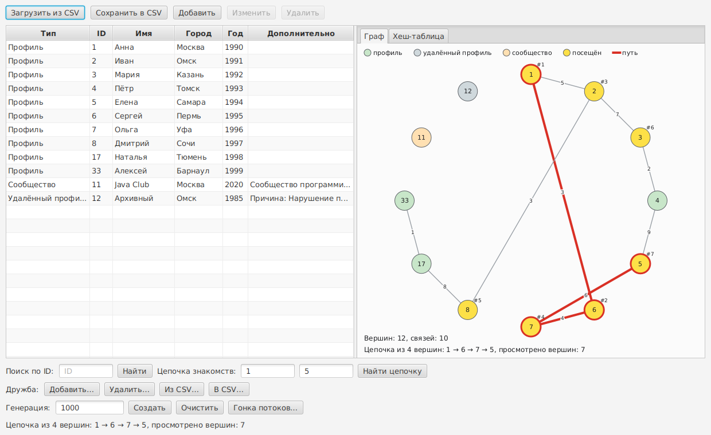

# Java_lab_1

Лабораторные работы по предмету «Программирование на Java».


## Лабораторная работа № 2 — «Социальная сеть», вариант 7

Продолжение первой лабораторной. Профили и дружбы теперь лежат в собственном графе: хеш-таблица вершин
на массивах и списки смежности на собственных узлах, без `java.util`. Приложение показывает внутреннее
устройство структуры, ищет кратчайшую цепочку знакомств, создаёт наборы данных и выполняет долгие
операции в фоне с прогрессом и отменой.

Стек: Java 21, Gradle Kotlin DSL (Wrapper 8.10.2), JavaFX 21, JUnit 5.



Версия первой лабораторной хранится в ветке [`lab12`](https://github.com/imaxxl/Java_lab_1/tree/lab12).

### Запуск

Нужен установленный JDK 21, Gradle ставить не нужно — Wrapper скачает сам.
Команды выполняются в корне репозитория.

Windows, PowerShell:

```
.\gradlew.bat run
```

Linux / macOS:

```
./gradlew run
```

Тесты: `./gradlew --no-daemon clean test`. Замеры времени: `./gradlew benchmark`.
Если Java не находится, укажите каталог JDK 21 в `JAVA_HOME`.

### Что умеет приложение

- Таблица профилей и кнопки первой лабораторной: загрузка и сохранение CSV, добавление, изменение,
  удаление. Изменить и удалить можно только записи с `Editable`, архивный профиль открыт только для чтения.
  Профиль, который администрирует сообщество, удалить нельзя.
- Панель структуры из двух вкладок: «Граф» (вершины по кругу, сила связи на рёбрах) и «Хеш-таблица»
  (корзины и цепочки узлов). Панель перерисовывается после каждой операции и подсвечивает посещённые узлы,
  найденный путь и найденный элемент. Показываются первые 40 вершин и 32 корзины, общие числа выводятся отдельно.
- Поиск по ID, кратчайшая цепочка знакомств между двумя профилями (обход в ширину), добавление и удаление дружб.
- Дружбы хранятся в отдельном CSV, загрузка и сохранение идут в фоне.
- «Создать» генерирует указанное число профилей и дружб. «Очистить» убирает все данные.
- Загрузка, сохранение, генерация выполняются в `Task`: виден индикатор прогресса, есть кнопка «Отмена».
  Отменённая генерация откатывается, отменённое сохранение не портит прежний файл.
- «Гонка потоков…» запускает опыт: несколько потоков пишут в граф без защиты и под `synchronized`.

Порядок демонстрации: загрузить `test.csv`, затем «Из CSV…» с файлом `example-friendships.csv` (две корректные
дружбы и пять строк с ошибками), найти цепочку между профилями 1 и 3, найти профиль на вкладке «Хеш-таблица»,
нажать «Создать» с числом 500000 и отменить генерацию на середине, открыть «Гонка потоков…».

### Структуры данных

Пакет `structure` не использует `java.util` (это проверяет тест).

| Класс | Назначение |
| --- | --- |
| `EntityStore<K, T>` | контракт: вставка, поиск по ключу, удаление, размер |
| `HashStore<K, T>` | хеш-таблица: массив корзин, цепочки узлов, список в порядке добавления, удвоение при заполнении 3/4 |
| `GraphStore<K, T>`, `AdjacencyGraph<K, T>` | граф: вершины в `HashStore`, списки смежности из узлов `Edge`, поиск цепочки обходом в ширину |
| `SynchronizedGraph<K, T>` | обёртка: каждая операция под одним замком |
| `Trace`, `Chain` | след операции для подсветки и результат поиска цепочки |
| `RaceExperiment` | опыт с гонкой потоков |

Асимптотика: вставка, поиск и замена вершины — O(1) в среднем; удаление вершины — O(1 + сумма степеней соседей);
добавление связи — O(min(deg a, deg b)); удаление связи — O(deg a + deg b); цепочка знакомств — O(V + E).

### Замеры

Среда: Linux amd64, 2 ядра, OpenJDK 21.0.13, медиана из пяти прогонов, время в миллисекундах.
Для сравнения используется аналог на `HashMap`, `ArrayList` и `ArrayDeque` из `src/bench`, в приложение он не входит.

| n = 100 000 | Своя структура | Своя + synchronized | java.util |
| --- | ---: | ---: | ---: |
| Вставка вершин | 6,8 | 7,3 | 9,4 |
| Вставка рёбер (3 на вершину) | 36,3 | 42,0 | 35,2 |
| Поиск вершины | 2,9 | 4,2 | 2,7 |
| Цепочка знакомств, 100 запросов | 1303,9 | 1196,7 | 2981,4 |
| Удаление вершин | 37,3 | 37,0 | 60,7 |

Полная таблица для 10 000 и 100 000 записей и график сравнения — в отчёте. Абсолютные числа зависят от машины.

### Формат файлов

Профили: UTF-8, разделитель `;`, обязательный заголовок, восемь колонок:

```
type;id;name;city;birthYear;description;administratorId;reason
```

Типы записей: `PROFILE`, `DELETED`, `COMMUNITY`. Неиспользуемые колонки остаются пустыми, BOM перед заголовком
допускается, поля с `;` или кавычками записываются в двойных кавычках.

Дружбы: заголовок и три колонки:

```
firstId;secondId;strength
```

Ошибка в строке не прерывает загрузку: строка пропускается, а её номер и код показываются в диалоге:
`BAD_HEADER`, `BAD_CSV_FORMAT`, `WRONG_FIELD_COUNT`, `EMPTY_FIELD`, `BAD_NUMBER`, `UNKNOWN_TYPE`,
`DUPLICATE_ID`, `DUPLICATE_FRIENDSHIP`, `INVALID_VALUE`, `INVALID_REFERENCE`.
Примеры: `src/main/resources/example.csv`, `example-quoted.csv`, `example-friendships.csv`.

### Структура проекта

- `src/main/java/ru/university/socialnetwork/model` — профили, сообщество, дружба;
- `.../structure` — собственные структуры данных;
- `.../store` — репозиторий профилей поверх графа, генератор данных;
- `.../csv` — разбор и безопасная запись файлов профилей и дружб;
- `.../gui` — окно, панель структуры, панель операций, диалоги, запуск фоновых задач;
- `src/bench` — замеры времени и аналог из `java.util`;
- `src/test` — 203 JUnit-теста, интерфейс проверяется без открытия окна;
- `docs` — отчёты по первой и второй лабораторным работам и скриншоты;
- `test.csv`, `test2.csv` — примеры файлов для демонстрации.

В `.github/workflows/java.yml` описан запуск `clean test` на Java 21 после каждого push.
